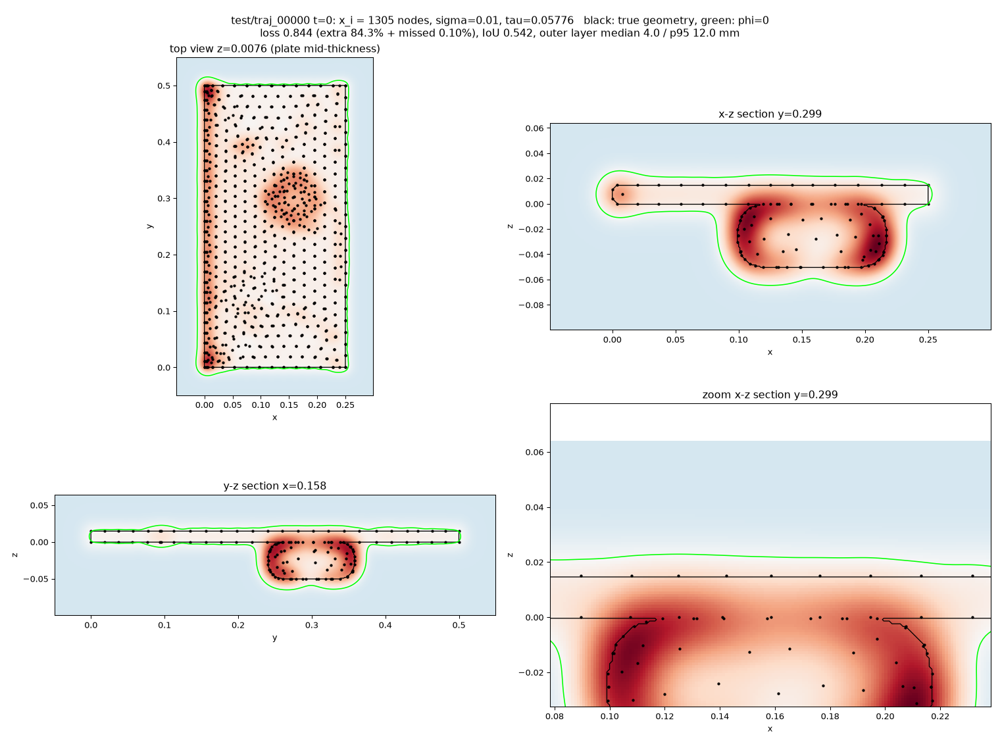

# phi-geometry: Gaussian-kernel geometry fields on DeformingPlate

This repository represents the geometry of a [MeshGraphNets](https://github.com/google-deepmind/deepmind-research/tree/master/meshgraphnets) `deforming_plate` snapshot by a Gaussian-kernel field built on the dataset's own mesh nodes:

$$
\phi(x) = -\tau + \frac{1}{n}\sum_{i=1}^{n} \frac{1}{\sqrt{2\pi}\,\sigma}\exp\!\Big(-\frac{\|x-x_i\|^2}{2\sigma^2}\Big),
\qquad \hat\Omega=\{\phi>0\}.
$$

The repository chooses $(\sigma,\tau)$ and measures the error of $\hat\Omega$ against the true geometry, which is the union of the dataset's tetrahedra. Short summary: [docs/report.md](docs/report.md). The method, the loss and the slice plots are described in [docs/methodology.md](docs/methodology.md).

Code layout follows [TANTE](https://github.com/zwu88/TANTE): Hydra configs, with `data/`, `models/` and `tuner/` as separate packages. Nothing is trained: $\sigma$ is grid-searched, and $\tau$ is set in closed form for each $\sigma$.

## 📦 Installation
```bash
conda create -n phi python=3.11 && conda activate phi
pip install -r requirements.txt
```

## 📚 Data
1. Download `deforming_plate` (`meta.json` and `{train,valid,test}.tfrecord`) with the DeepMind `download_dataset.sh`.
2. Convert it to HDF5:
   ```bash
   python scripts/tfrecord_to_h5.py --in_dir <raw dir> --out_root <root>   # or: sbatch scripts/convert.sbatch
   ```
   This writes
   ```
   <root>/deforming_plate/data/{train,valid,test}/deforming_plate_<split>.h5
   ```
3. Set `data.base_path=<root>` in `configs/phi.yaml`.

`scripts/dataset_stats.py` summarizes how plate shape, thickness and actuator size and motion vary across trajectories.

## 🚀 Tuning
```bash
python tune.py                                             # test/traj_00000, t=0, plate + actuator
python tune.py data.traj=traj_00010 data.t=200             # another trajectory / time step
python tune.py data.with_obstacle=False                    # plate only
sbatch slurm/tune.sbatch data.split_name=train data.traj=traj_00005
```
Outputs go to `<root_path>/experiments/<experiment>/`:
- `tune_results.json`: every $(\sigma,\tau)$ and its metrics
- `best.yaml`: the recommended setting
- `slices_*.png`: slice figures for the recommended setting

The 3D grid (~35M voxels at 1 mm) needs ~20 GB RAM.

## 🔎 Evaluation of a fixed setting
```bash
python eval.py model.sigma=0.01 model.tau=0.058
python eval.py                                             # uses experiments/<experiment>/best.yaml
```

## 🏆 Result (test/traj_00000, t = 0, plate + actuator, n = 1305)
| $\sigma$ | $\tau$ | loss (extra + missed) | IoU | missed | outer error layer median / p95 |
|---|---|---|---|---|---|
| 0.010 | 0.0578 | 0.844 | 0.542 | 0.1 % | 4.0 / 12.0 mm |



In the figure, black is the true boundary and green is $\phi=0$. The full table and the discussion of why the error floor is high are in [docs/methodology.md](docs/methodology.md).
