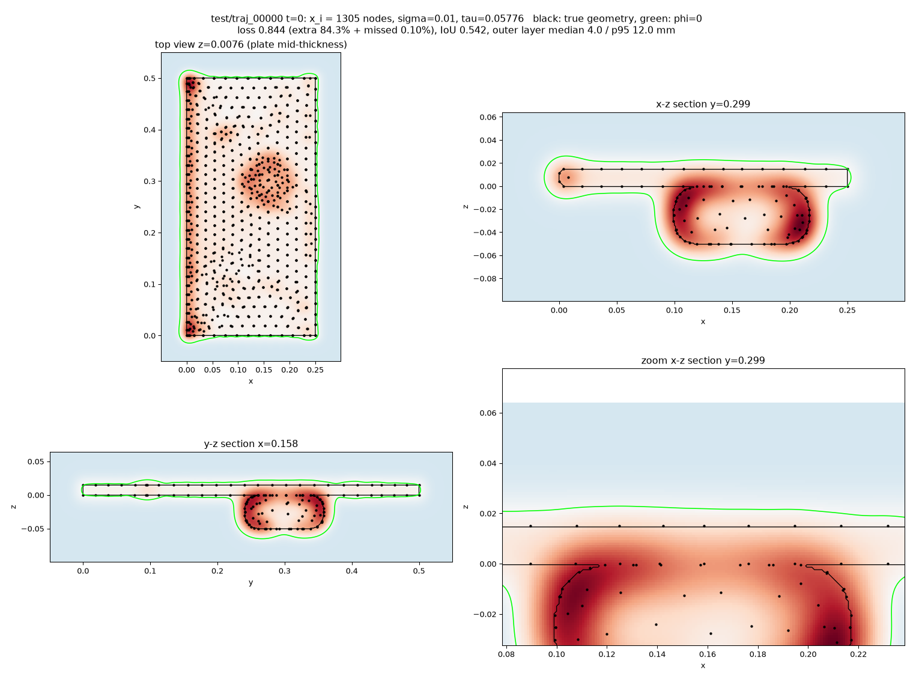

# Methodology

This note describes how the Gaussian-kernel geometry field is built from the dataset's points, how its error against the true geometry is measured, how $(\sigma,\tau)$ are chosen, and how the slice figures (the green $\phi=0$ curves) are drawn.

## 1. Geometry field

Let $x_1,\dots,x_n\in\mathbb{R}^3$ be the mesh nodes of one deforming_plate snapshot. They are used **unchanged**: no resampling and no extra points. For `test/traj_00000`, $t=0$, $n=1305$ (922 plate + 383 actuator nodes).

$$
\phi(x) = -\tau + \frac{1}{n}\sum_{i=1}^{n} \frac{1}{\sqrt{2\pi}\,\sigma}\exp\!\Big(-\frac{\|x-x_i\|^2}{2\sigma^2}\Big),
\qquad
\hat\Omega = \{x:\ \phi(x)>0\}.
$$

It is convenient to write $\phi = -\tau + \kappa\,S(x)$, where

$$
S(x)=\sum_{i=1}^{n}\exp\!\Big(-\frac{\|x-x_i\|^2}{2\sigma^2}\Big)
\qquad\text{and}\qquad
\kappa=\frac{1}{n\sqrt{2\pi}\,\sigma}.
$$

Then $\phi(x)>0 \iff S(x) > \tau/\kappa$.

## 2. Ground truth

Each trajectory stores `cells`, the tetrahedra $T_1,\dots,T_K$ of the finite-element mesh ($K=4018$ here). The true geometry is their union:

$$
\Omega=\bigcup_{k=1}^{K}T_k,\qquad \chi(x)=\mathbb{1}[x\in\Omega].
$$

**Membership test.** For $T_k$ with vertices $p_0,\dots,p_3$, solve $[\,p_1-p_0,\ p_2-p_0,\ p_3-p_0\,]\,\lambda = x-p_0$. Then $x\in T_k$ iff $\lambda_j\ge 0$ for all $j$ and $\sum_j\lambda_j\le 1$.

This is the discretized geometry used by the simulator, not a convex hull of the points, so notches, holes and the actuator's shape are all exact. Curved surfaces, such as the actuator's rounded edge, are only as accurate as the mesh's flat faces.

## 3. Evaluation grid

All integrals are evaluated on a voxel-centred grid. Its spacing is $h=1$ mm, and it covers the points' bounding box padded by 5 cm:

$$
\mathcal{G}=\{\,g=\ell+(a+\tfrac12,\ b+\tfrac12,\ c+\tfrac12)\,h\,\}.
$$

For the example this is $350\times600\times165\approx 3.5\times10^{7}$ voxels.

- **$\chi(g)$:** tested for every voxel centre (`tuner/grid.py: VoxelGrid.rasterize`).
- **$S(g)$:** computed exactly by accumulating each point's separable Gaussian into a box of half-width $4\sigma$ around it (`models/gaussian_phi.py`). Dropped contributions are each below $e^{-8}\approx3\times10^{-4}$ of one point's peak.
- **Voxelized volume:** $V=h^3\sum_g\chi(g)=2.342\times10^{-3}$, against an exact tetrahedron volume of $2.353\times10^{-3}$ (0.5 % discretization error).

There is no random sampling: every voxel is tested, so each sum below is a midpoint-rule approximation of a volume integral.

## 4. Error measures (the "loss")

Over-coverage (false positives) and under-coverage (false negatives):

$$
\mathrm{FP}=\{g\in\mathcal G:\ \phi(g)>0,\ \chi(g)=0\},\qquad
\mathrm{FN}=\{g\in\mathcal G:\ \phi(g)\le0,\ \chi(g)=1\}.
$$

**Total loss.** The symmetric-difference volume relative to the true volume:

$$
\mathcal L(\sigma,\tau)=\frac{|\hat\Omega\,\triangle\,\Omega|}{|\Omega|}
\approx\frac{h^3}{V}\sum_{g\in\mathcal G}\Big(\mathbb 1[\phi(g)>0]\,(1-\chi(g))+\mathbb 1[\phi(g)\le0]\,\chi(g)\Big)
=\underbrace{\frac{h^3|\mathrm{FP}|}{V}}_{\text{extra}}+\underbrace{\frac{h^3|\mathrm{FN}|}{V}}_{\text{missed}}.
$$

**Further measures:**

$$
\mathrm{IoU}=\frac{|\{\phi>0\}\cap\{\chi=1\}|}{|\{\phi>0\}\cup\{\chi=1\}|}.
$$

- **Outer error layer:** $d(g)=\operatorname{dist}(g,\Omega)$ for $g\in\mathrm{FP}$, reported as median, 95th percentile and maximum. $\operatorname{dist}$ is the Euclidean distance transform of the voxel mask, accurate to about $h$.
- **Missed depth:** $\max_{g\in\mathrm{FN}}\operatorname{dist}(g,\partial\Omega)$.
- **Per-body split:** each FP voxel is assigned to the closer body (plate or actuator), and extra and missed volume are reported per body.

Code: `tuner/metrics.py: geometry_metrics`.

## 5. Choosing $\sigma$ and $\tau$ (no training)

$\phi$ has only two scalar parameters, so nothing is trained by gradient descent.

1. **$\sigma$** is grid-searched over $\{0.004, 0.006, 0.008, 0.010, 0.012\}$ m.
2. **$\tau$ for a fixed $\sigma$.** $\phi>0 \iff S>\tau/\kappa$, so the missed fraction is the empirical CDF of $S$ over the inside voxels:
   $$\text{missed}(\tau)=\frac{|\{g:\chi(g)=1,\ S(g)\le\tau/\kappa\}|}{|\{g:\chi(g)=1\}|}.$$
   Two choices are reported:
   - **solid:** the largest $\tau$ with missed $\le\varepsilon$, with $\varepsilon=10^{-3}$. In closed form,
     $$\tau^*(\sigma)=\kappa\,Q_\varepsilon\big(\{S(g):\chi(g)=1\}\big),$$
     where $Q_\varepsilon$ is the $\varepsilon$-quantile.
   - **min-error:** $\tau=\arg\min\mathcal L(\sigma,\tau)$ over 201 candidates. The candidates are $\kappa$ times the $0,\dots,0.5$ quantiles of $S$ over the inside voxels. This choice allows part of the interior to be missed.
3. **Recommended setting.** $\arg\min_\sigma \mathcal L(\sigma,\tau^*(\sigma))$, i.e. the solid choice with the smallest loss.

**Scaling of $\tau$.** $\kappa$ contains $1/n$, so a fixed $\tau$ means a different threshold on $S$ for meshes with different $n$. Transfer settings between trajectories through $\tau/\kappa$, not $\tau$.

Code: `tuner/tuner.py: Tuner.tune`.

## 6. Slice figures and the green line

The slices are for **display only**. Every number above comes from the full 3D grid. $\{\phi=0\}$ is a surface in 3D, so the curve differs from slice to slice.

### 6.1 Choosing the plane

To show the plane $x_a=c$, the grid plane through the nearest voxel centre is taken, $k^*=\arg\min_k|x_{a,k}-c|$. On that plane $\phi$ is known exactly at every grid node, with no interpolation across planes. The result is a 2D array $F_{jl}=\phi(u_j,v_l)$ on the in-plane axes $u, v$.

### 6.2 Green line: marching squares with linear interpolation

The curve $\{\phi=0\}$ in the plane is extracted with matplotlib `contour(u, v, F, levels=[0])`, which uses the contourpy marching-squares algorithm:

1. **Classify corners.** Each grid cell $[u_j,u_{j+1}]\times[v_l,v_{l+1}]$ has four corner values. Each corner is labelled by the sign of $\phi$, giving one of $2^4=16$ cases.
2. **Find edge crossings.** On every cell edge whose endpoints $a,b$ have opposite signs, the crossing is placed by linear interpolation:
   $$t=\frac{\phi_a}{\phi_a-\phi_b}\in[0,1],\qquad p=p_a+t\,(p_b-p_a).$$
3. **Connect.** Within each cell, the crossing points are joined by straight segments according to the case table. In the two saddle cases (diagonally opposite corners share a sign), contourpy's built-in rule decides which pairs to connect. Segments are chained across cells into polylines.

Linear interpolation along an edge is exact when $\phi$ is linear along that edge. For smooth $\phi$, the curve position error is $O(h^2)$, well below $h=1$ mm. Here $\phi$ varies on the scale $\sigma\ge4$ mm, which is several grid spacings.

### 6.3 Black line: the true boundary

The same routine is applied to $\chi$ (values 0 or 1) at level 0.5. Every crossing then sits exactly halfway between an inside and an outside voxel centre ($t=1/2$). The black line is therefore a staircase approximation of $\partial\Omega\cap\text{plane}$, accurate to $\pm h/2$.

### 6.4 Other elements of the figure

- **Background:** $F$, red for $\phi>0$ and blue for $\phi<0$.
- **Dots:** the $x_i$ within $\sigma$ of the plane.

## 7. Result: test/traj_00000, t = 0, plate + actuator

| $\sigma$ | choice | $\tau$ | loss | IoU | extra | missed | outer layer med / p95 / max [mm] |
|---|---|---|---|---|---|---|---|
| 0.004 | solid | 0.00057 | 1.427 | 0.412 | 142.6 % | 0.10 % | 6.0 / 11.4 / 13.9 |
| 0.006 | solid | 0.01289 | 1.167 | 0.461 | 116.6 % | 0.10 % | 5.0 / 10.0 / 14.0 |
| 0.008 | solid | 0.03670 | 0.883 | 0.531 | 88.2 % | 0.10 % | 4.0 / 10.6 / 15.0 |
| **0.010** | **solid** | **0.05776** | **0.844** | **0.542** | **84.3 %** | **0.10 %** | **4.0 / 12.0 / 17.1** |
| 0.012 | solid | 0.07275 | 1.062 | 0.485 | 106.1 % | 0.10 % | 5.0 / 13.5 / 20.0 |
| 0.010 | min-error | 0.06796 | 0.643 | 0.591 | 57.3 % | 7.00 % | 4.0 / 11.2 / 16.3 |

With the plate alone (`data.with_obstacle=False`, $n=922$), $\sigma=0.010$ gives $\tau=0.0819$, IoU 0.551 and extra 81.3 %. Including the actuator therefore does not change how well the plate is represented.

## 8. Why the error floor is high

The plate is 15 mm thick, and its nodes lie only on its top and bottom faces, 10–30 mm apart in-plane.

- **Interior gaps.** For the interior to stay inside ($\phi>0$ between distant nodes), $S$ must exceed the threshold far from any node. That forces a low threshold.
- **Outward bulge.** A low threshold makes $\{\phi>0\}$ extend about 4 mm (median) beyond each face, which is roughly half the plate's thickness on each side.
- **The trade-off.** A smaller $\sigma$ opens holes inside; a larger $\sigma$ thickens the outer layer.

With a single isotropic $\sigma$ and these points, the loss cannot go far below about 0.6 (min-error) or 0.84 (solid).

## 9. Approximations and their sizes

| source | size |
|---|---|
| voxelization of $\Omega$ ($h=1$ mm) | volume error 0.5 %; boundary within $\pm h/2$ |
| kernel truncation at $4\sigma$ | $\le e^{-8}$ of one peak per dropped point |
| distance transform | about $h$ |
| contour position (green line) | $O(h^2)$ for smooth $\phi$ |
