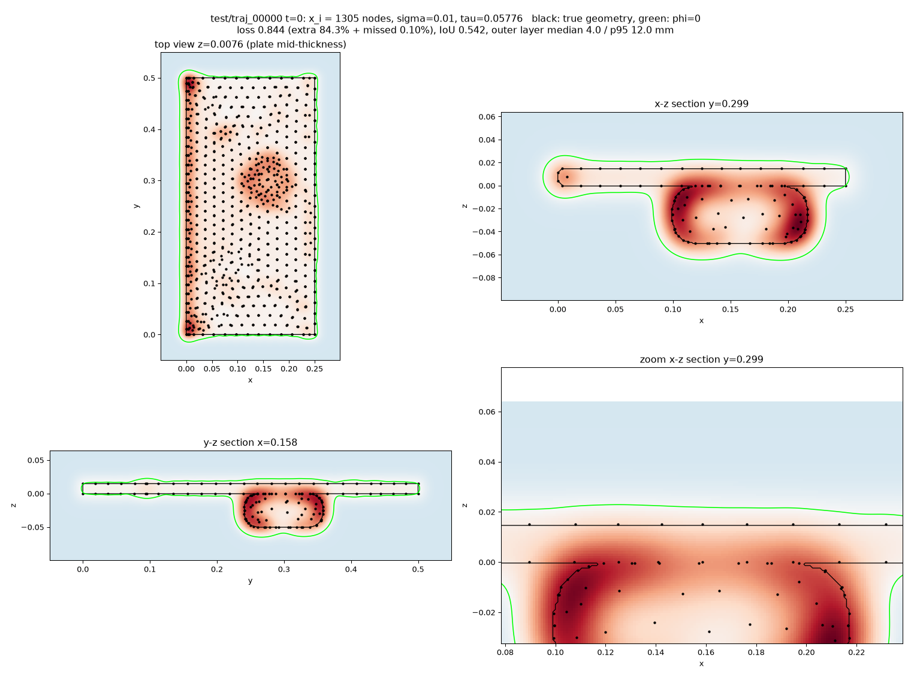

# Report: Gaussian-kernel geometry on DeformingPlate

## Setup
- **Data:** `deforming_plate`, test trajectory `traj_00000`, time step $t=0$. The plate is a 0.25 × 0.5 × 0.015 m box, with an actuator underneath it.
- **Points:** $x_i$ are the dataset's mesh nodes, unchanged: $n = 1305$ (922 plate + 383 actuator).
- **True geometry $\Omega$:** the union of the dataset's tetrahedra.

## Method
$$
\phi(x) = -\tau + \frac{1}{n}\sum_{i=1}^{n} \frac{1}{\sqrt{2\pi}\,\sigma}\exp\!\Big(-\frac{\|x-x_i\|^2}{2\sigma^2}\Big),
\qquad \hat\Omega=\{x:\phi(x)>0\}
$$

- **$\sigma$:** the kernel width.
- **$\tau$:** the threshold; $x$ counts as inside if $\phi(x) > 0$.

**Loss.** The volume where $\hat\Omega$ and $\Omega$ disagree, relative to the true volume. It is computed on a 1 mm voxel grid of about 35M points.

$$
\text{loss} = \underbrace{\frac{|\hat\Omega\setminus\Omega|}{|\Omega|}}_{\text{extra}} + \underbrace{\frac{|\Omega\setminus\hat\Omega|}{|\Omega|}}_{\text{missed}}
$$

**Choosing the parameters (no training).**
1. $\sigma$ is tried over 5 values.
2. For each $\sigma$, $\tau$ is the largest value that keeps the shape solid (missed ≤ 0.1 %).
3. The pair with the lowest loss is kept.

## Results

| $\sigma$ (m) | $\tau$ | loss | extra | missed | IoU |
|---|---|---|---|---|---|
| 0.004 | 0.00057 | 1.43 | 142.6 % | 0.1 % | 0.41 |
| 0.006 | 0.01289 | 1.17 | 116.6 % | 0.1 % | 0.46 |
| 0.008 | 0.03670 | 0.88 | 88.2 % | 0.1 % | 0.53 |
| **0.010** | **0.05776** | **0.84** | **84.3 %** | **0.1 %** | **0.54** |
| 0.012 | 0.07275 | 1.06 | 106.1 % | 0.1 % | 0.49 |

**Best: $\sigma = 0.010$, $\tau = 0.0578$, loss = 0.84.** The shape is solid, and the error is an outer layer about 4 mm thick (median; 12 mm at the 95th percentile).

In the figure, black is the true boundary and green is $\phi = 0$.

## Takeaway
- **What works:** with the dataset's points alone, the plate and actuator are represented as solid with their outlines correct.
- **What limits it:** the plate is only 15 mm thick, and its nodes lie only on its two faces, 10–30 mm apart. A solid interior therefore forces a low threshold, which inflates the shape by about 4 mm per side.
- **How far the loss can go:** about 0.84 if the shape must be solid. If ~7 % of the interior may be missed, it drops to 0.64 ($\tau = 0.068$).

Details (exact definitions, how $\tau$ is computed, how the plots are drawn): [methodology.md](methodology.md).
